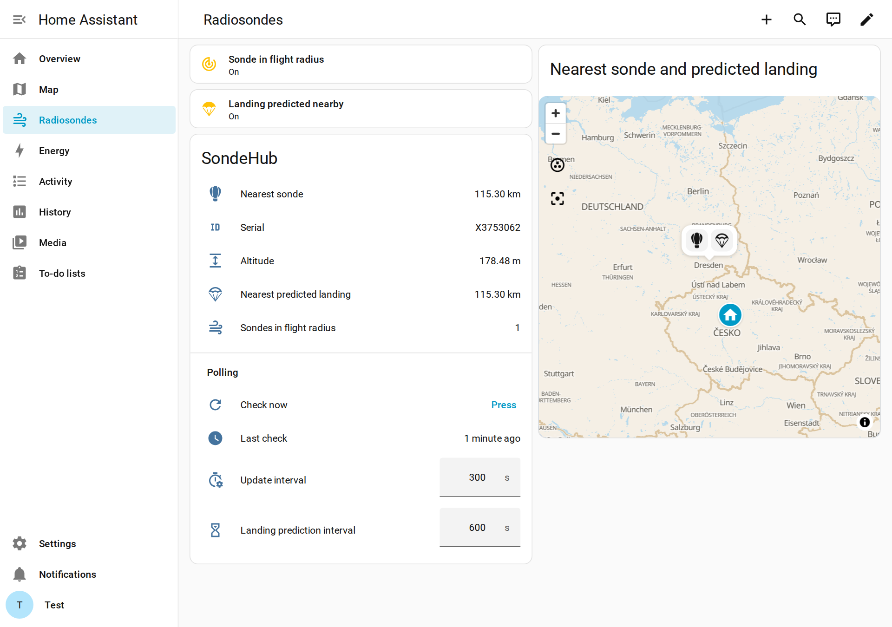
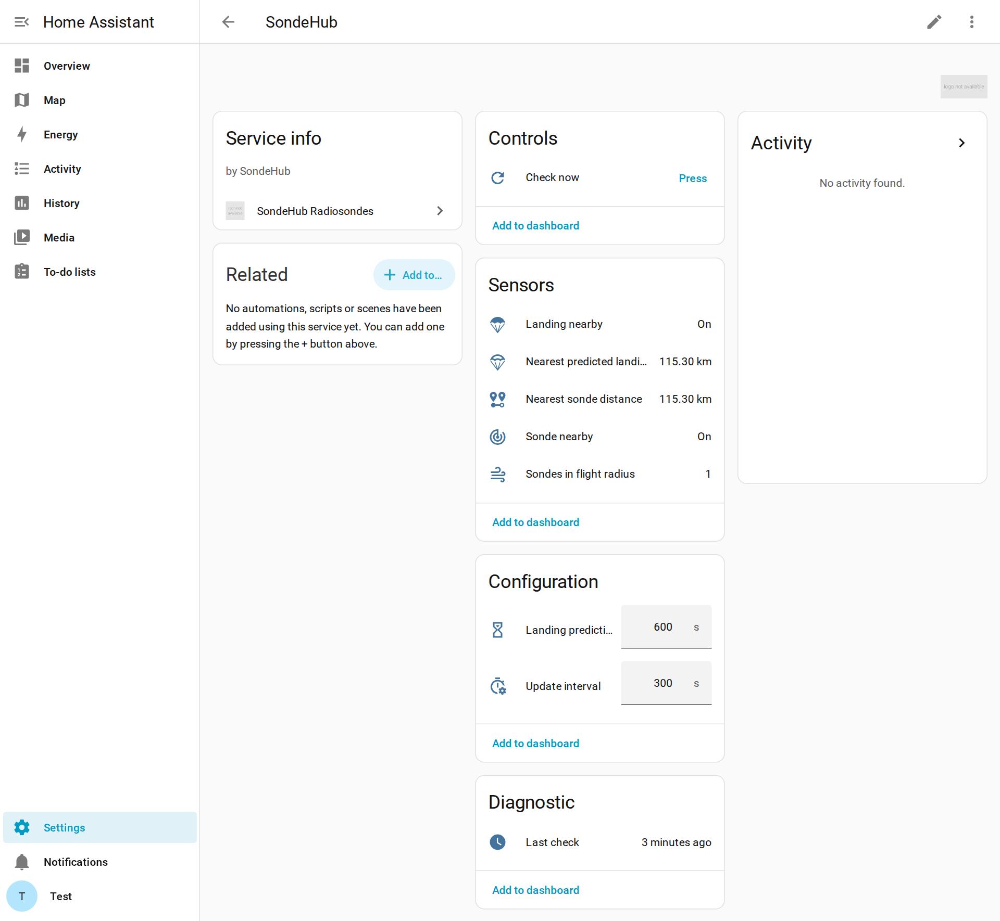

# SondeHub Radiosondes for Home Assistant

Custom integration (HACS compatible) that follows weather radiosondes through
the public [SondeHub](https://sondehub.org) API and tells you when:

- a sonde is **flying** within a given radius of your home;
- a sonde is **predicted to land** (or has landed) near your home.

Code under the [MIT license](LICENSE). Data © SondeHub, licensed CC BY-SA 2.0.



## Requirements

- Home Assistant **2024.11** or newer (tested on 2026.10).
- Internet access to `api.v2.sondehub.org`. No account or API key needed.

## Install on Home Assistant

Pick **one** of the methods below, then continue with
[Set up the integration](#set-up-the-integration).

### Option A: HACS (recommended, you get update notifications)

Needs this repository to be on GitHub (public).

1. HACS → ⋮ (top right) → **Custom repositories**.
2. Repository: `https://github.com/alexandre-bonnefond/ha-sondehub`,
   type **Integration** → **Add**.
3. Search for **SondeHub Radiosondes** in HACS → **Download**.
4. **Restart Home Assistant** (Settings → System → ⏻ → Restart).

### Option B: copy the files by hand

Copy the folder `custom_components/sondehub/` from this repo into the
`custom_components/` folder of your Home Assistant config directory (create it
if needed), so you end up with:

```
<config>/custom_components/sondehub/__init__.py
<config>/custom_components/sondehub/manifest.json
...
```

Ways to reach `<config>`:

| Your setup | How |
|---|---|
| HA OS / Supervised + **Samba share** add-on | open `\\homeassistant.local\config` (Windows) or `smb://homeassistant.local/config` (Linux/macOS) and drag the folder in |
| HA OS / Supervised + **SSH** add-on | run `scripts/deploy.sh` from this repo (see below) |
| HA OS + **Studio Code Server** / **File editor** add-on | create `custom_components/sondehub/` and upload the files |
| HA Container (Docker) / Core | copy into the directory mounted as `/config` |

Then **restart Home Assistant**.

#### Deploy over SSH (`scripts/deploy.sh`)

With the *Terminal & SSH* or *Advanced SSH & Web Terminal* add-on installed and
your SSH key added to it:

```bash
scripts/deploy.sh root@homeassistant.local --restart
```

It copies the integration and the blueprint to `/config`, checks the
configuration and restarts Home Assistant Core. Without `--restart` it only
copies. Set `HA_SSH_PORT` if the add-on doesn't listen on port 22, and
`HA_CONFIG_DIR` if your config directory isn't `/config`.

### Set up the integration

1. Settings → Devices & services → **Add integration** → search
   **SondeHub Radiosondes**.
2. Check the location (defaults to your Home location), the radii and the
   request intervals (see [Request frequency](#request-frequency)) →
   **Submit**.

You can add several locations (e.g. home and a cottage); each one is a separate
entry with its own entities.

### Phone notifications (optional blueprint)

The blueprint sends a notification through the Home Assistant mobile app when
a sonde enters your flight radius or is predicted to land nearby.

1. Copy `blueprints/automation/sondehub/notify_sonde.yaml` to
   `<config>/blueprints/automation/sondehub/` (`scripts/deploy.sh` already does
   it). Once the repo is on GitHub you can instead use Settings → Automations &
   scenes → Blueprints → **Import blueprint** with
   `https://github.com/alexandre-bonnefond/ha-sondehub/blob/main/blueprints/automation/sondehub/notify_sonde.yaml`.
2. Settings → Automations & scenes → Blueprints → **SondeHub - notification
   radiosonde** → **Create automation**, pick your phone, save.

### Dashboard (optional)

[`examples/dashboard.yaml`](examples/dashboard.yaml) is the dashboard shown in
the screenshot above: status tiles, details, polling controls, and a map with
the nearest sonde (balloon) and the nearest predicted landing (parachute).

1. Settings → Dashboards → **+ Add dashboard** → **New dashboard from
   scratch** → title `Radiosondes` → **Create**. It appears in the sidebar.
2. Open it → ✏️ (top right) → ⋮ → **Raw configuration editor**.
3. Replace everything with the content of `examples/dashboard.yaml` → **Save**
   → **Done**.

The file assumes the default entity ids (`sensor.sondehub_…`). If you named
the integration entry differently, adjust the `sondehub_` prefix.

## Request frequency

SondeHub is a free community service. Its API documentation asks clients
**not to poll regularly** and the endpoints are rate limited, so this
integration keeps requests low:

- **Update interval** (default **300 s**): one `/sondes` request (positions of
  every sonde in the watch radius).
- **Landing prediction interval** (default **600 s**): one `/predictions`
  request for *all* tracked sondes at once. It is only sent while there are
  sondes in the watch radius, plus once when a new sonde appears.

At the defaults that is at most ~18 requests per hour, and 12 per hour when the
sky is empty. Both intervals accept 60–3600 s.

You can change them in three places. They are the same setting:

- Settings → Devices & services → SondeHub → ⚙️ **Configure**
  ([screenshot](docs/images/options.png));
- the **Update interval** / **Landing prediction interval** entities on the
  device page or on a dashboard. These apply immediately, without reloading;
- an automation, with `number.set_value`. Example: poll faster only while a
  sonde is nearby:

  ```yaml
  triggers:
    - trigger: state
      entity_id: binary_sensor.sondehub_sonde_nearby
  actions:
    - action: number.set_value
      target:
        entity_id: number.sondehub_update_interval
      data:
        value: "{{ 120 if trigger.to_state.state == 'on' else 600 }}"
  ```

**Check now**: the `button.sondehub_check_now` entity fetches positions *and*
predictions right away. Presses less than 30 s apart are merged into a single
extra request, so it can't hammer the API.

**Manual only**: to never poll automatically, open the integration's ⋮ menu →
**System options** → turn off *Enable polling for updates*. The integration
then only checks when you (or an automation) press **Check now**.

If SondeHub answers *429 Too Many Requests*, the integration stops calling it
for the time the server asks for (10 min if it doesn't say) and the error
shows up in the Home Assistant log.

## Entities



| Entity | Description |
|---|---|
| `binary_sensor.<name>_sonde_nearby` | on while a sonde flies inside the flight radius |
| `binary_sensor.<name>_landing_nearby` | on while a landing is predicted inside the landing radius |
| `sensor.<name>_nearest_sonde_distance` | km to the nearest sonde |
| `sensor.<name>_nearest_predicted_landing_distance` | km to the nearest predicted landing |
| `sensor.<name>_sondes_in_flight_radius` | number of sondes inside the flight radius |
| `button.<name>_check_now` | poll SondeHub immediately |
| `number.<name>_update_interval` | seconds between position requests |
| `number.<name>_landing_prediction_interval` | seconds between prediction requests |
| `sensor.<name>_last_check` | time of the last successful poll (diagnostic) |

The distance and binary sensors carry the details of the relevant sonde as
attributes: `serial`, `sonde_type`, `frequency_mhz`, `latitude`, `longitude`,
`altitude_m`, `vertical_speed_ms`, `descending`, `distance_km`, `bearing`,
`last_frame`, `landing_latitude`, `landing_longitude`, `landing_distance_km`,
`landing_bearing`, `landing_time`, `landed`.

Because they have `latitude`/`longitude`, these entities also show up on
maps, including the sidebar **Map**, which labels them with the initials of
their name: `SNs` = *SondeHub Nearest sonde distance*, `SNp` = *SondeHub
Nearest predicted landing distance*, `SSn` / `SLn` = *Sonde nearby* /
*Landing nearby* (only while on). The sonde entities sit at the sonde's last
position. The landing entities (`…_nearest_predicted_landing_distance`,
`…_landing_nearby`) sit at the **predicted landing spot**, and carry the
sonde's own position as `sonde_latitude` / `sonde_longitude`.

## Events

`sondehub_sonde_nearby` and `sondehub_landing_nearby` fire **once per sonde**
(remembered across restarts for 3 days). Fields: `serial`, `type`, `subtype`,
`frequency`, `latitude`, `longitude`, `altitude`, `vertical_speed`,
`descending`, `distance_km`, `bearing`, `landing_latitude`,
`landing_longitude`, `landing_distance_km`, `landing_bearing`,
`landing_time` (ISO 8601, UTC), `landed`, `sondehub_url`, `maps_url`.

## Troubleshooting

- To see each request the integration makes, open the integration page → ⋮ →
  **Enable debug logging**. Every request is logged as `GET /sondes …` or
  `GET /predictions …`.
- The `/predictions` endpoint is marked *deprecated* in SondeHub's API spec. If
  it disappears, only the landing part (`api.py`) needs adapting.

## Development

```
custom_components/sondehub/   the integration
blueprints/                   notification blueprint
examples/dashboard.yaml       example dashboard view
scripts/dev.sh                run a throwaway Home Assistant in Docker with this integration
scripts/deploy.sh             copy to a real Home Assistant over SSH
.github/workflows/            hassfest + HACS validation
```

Preview locally (needs Docker), then open <http://localhost:8123>:

```bash
scripts/dev.sh
```

The integration folder is mounted read-only, so after editing the code you only
need to restart that Home Assistant (Settings → System → Restart, or stop and
rerun the script). Its config lives in the Docker volume `ha-sondehub-dev`;
`docker volume rm ha-sondehub-dev` starts over from scratch.
